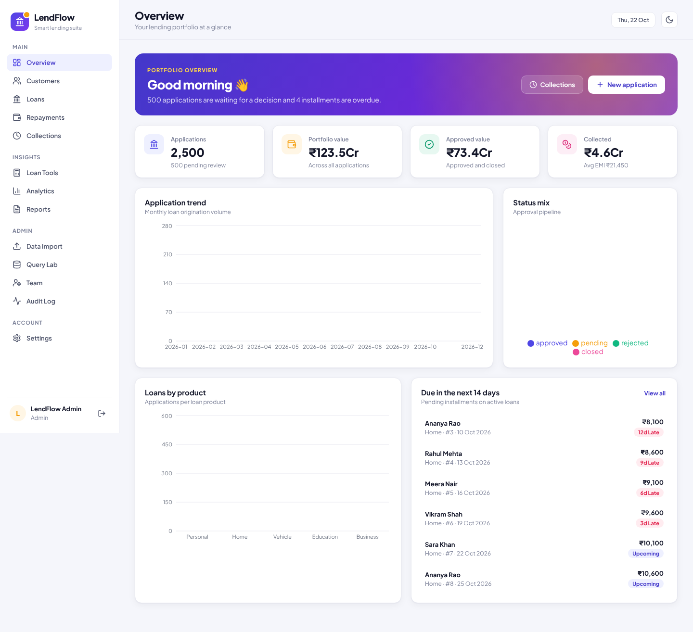
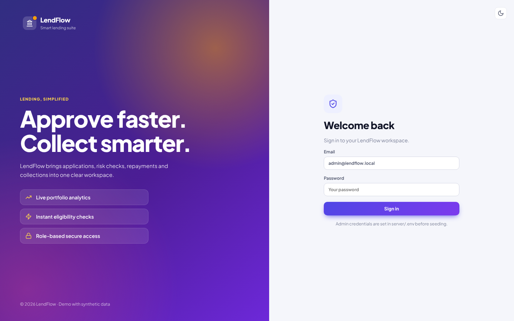
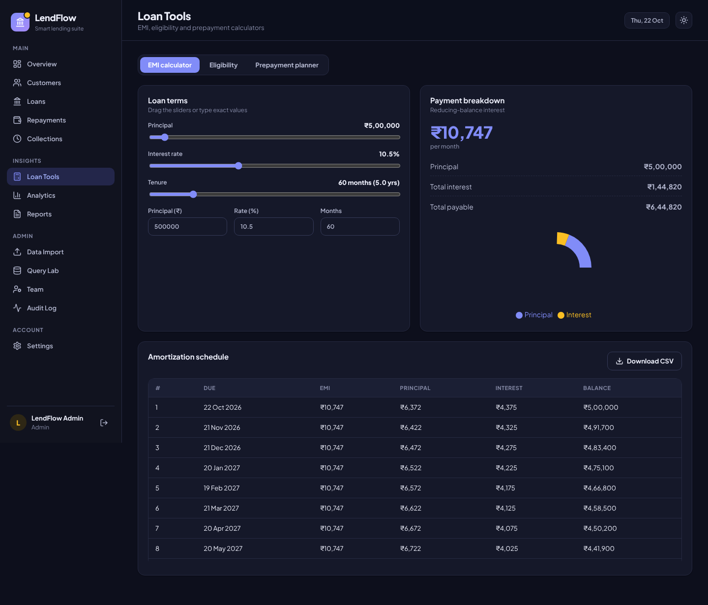
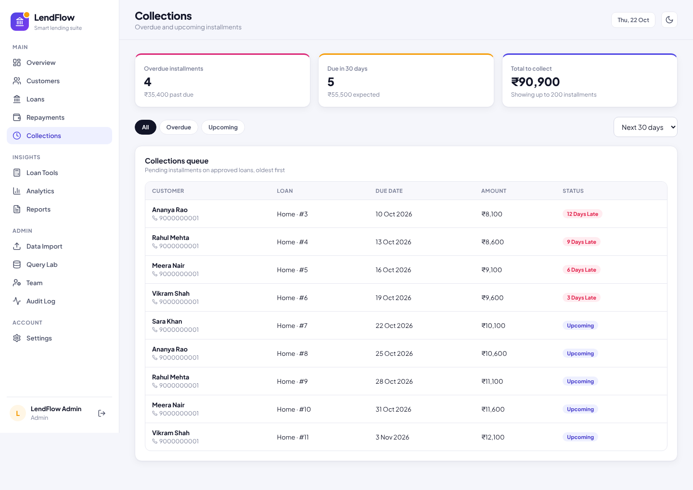
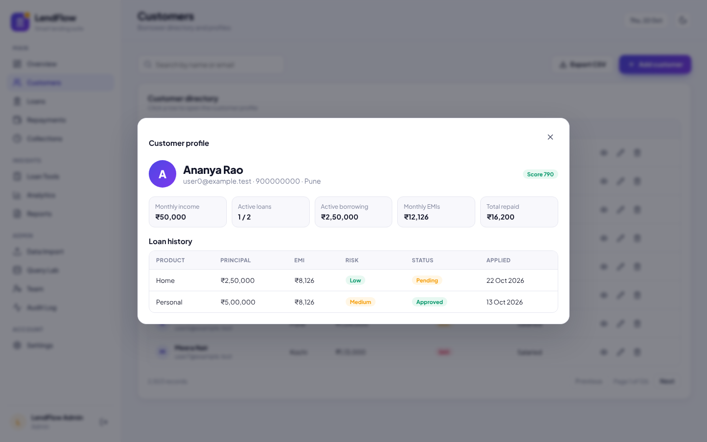

# LendFlow — Smart Lending Suite

LendFlow is a full-stack loan management and analytics app built with **React + Vite**, **Node.js + Express**, **MongoDB (Mongoose)**, **Recharts** and **JWT** authentication. It covers the whole lending workflow: customers, loan applications, risk checks, approvals, EMI repayments, collections and portfolio analytics.

> Demo project that uses synthetic data. **Not for real lending decisions.**



| Light sign-in | Dark mode |
| --- | --- |
|  |  |
|  |  |

## What's new in LendFlow

LendFlow is based on the public **LoanSphere** academic project by [Aadhinath5527](https://github.com/Aadhinath5527/LoanSphere_FullStack_Project). It has been rebranded, redesigned and extended:

**New design**
- Indigo and amber colour system with **light and dark themes** (follows your OS setting and remembers your choice).
- Rebuilt layout: grouped sidebar, sticky header with page descriptions, gradient hero, refreshed stat cards, chips, tabs and toasts.
- Fully responsive with a slide-out mobile menu.
- The frontend has been rewritten from one minified file into readable modules (`lib.js`, `components.jsx`, `pages.jsx`, `tools.jsx`).

**New features**
- **Collections queue**: overdue and upcoming installments across all active loans, showing days late and totals (7–90 day window).
- **Loan eligibility checker**: estimates the maximum safe loan and EMI from income, existing EMIs and credit score, using a FOIR rule.
- **Live eligibility hint** on the new-application form, so an officer sees immediately if the requested amount is too high.
- **Prepayment planner**: shows interest saved and compares reducing the tenure with reducing the EMI after a lump-sum payment.
- **Customer 360° profile**: income, active loans, total borrowing, combined EMIs, amount repaid and full loan history.
- **Loan detail view** with a repayment progress bar and overdue markers.
- **CSV export** of customers, loans and EMI schedules.
- **Team management**: admins can create officer or admin accounts. The original project had no way to add users.
- **Settings page**: change your password and switch themes.
- **Customer delete** button for admins. The original API supported delete, but the UI had no button for it.
- EMI calculator with sliders, debounced search, loan product filter, and automatic sign-out when a session expires.
- Added the missing `server/.env.example`, unit tests for the new calculations, and removed a self-referencing dependency from the `package.json` files.

## Prerequisites
- Node.js 20+ and npm
- MongoDB running locally on port 27017, **or** a MongoDB Atlas connection string
- Recording EMI repayments uses MongoDB transactions, so it needs a **replica set** (any Atlas cluster, or a local single-node replica set).

## Setup
1. `npm run install:all`
2. `npm run setup` — asks for your MongoDB connection string and an admin email/password, writes `server/.env` (with a random `JWT_SECRET`) and tests the database connection. You can also copy `server/.env.example` to `server/.env` and edit it by hand.
3. `npm run seed` — creates the admin user plus 2,500 synthetic customers and loans. Every run adds another batch. Pass a count with `npm run seed --prefix server -- 5000`.
4. `npm run dev`
5. Open http://localhost:5173 and sign in with the admin email and password from `server/.env`.

API health check: http://localhost:5000/api/health

## Project structure
```
├── client/                 React + Vite frontend
│   └── src/
│       ├── main.jsx        App shell, navigation, theme, login
│       ├── lib.js          API client, formatters, hooks, chart palettes
│       ├── components.jsx  Shared UI (panels, tables, modals, charts)
│       ├── pages.jsx       Overview, customers, loans, repayments, analytics, admin pages
│       ├── tools.jsx       Loan tools, collections, team, settings
│       └── style.css       Design tokens and styles (light + dark)
├── server/                 Express API
│   ├── .env.example
│   └── src/
│       ├── index.js        Routes
│       ├── models.js       Mongoose schemas and indexes
│       ├── logic.js        EMI, amortization, risk, eligibility, prepayment
│       ├── logic.test.js
│       └── seed.js
├── docs/screenshots/
└── sample_customers.csv
```

## API endpoints
| Area | Endpoints |
| --- | --- |
| Auth | `POST /api/auth/login`, `GET /api/auth/me`, `PATCH /api/auth/password` |
| Team (admin) | `GET /api/users`, `POST /api/users` |
| Customers | `GET/POST /api/customers`, `PUT/DELETE /api/customers/:id`, `GET /api/customers/:id/profile` |
| Loans | `GET/POST /api/loans`, `GET /api/loans/:id`, `PATCH /api/loans/:id/status` |
| Repayments | `POST /api/loans/:id/repayments`, `GET /api/repayments`, `GET /api/installments/due?days=30` |
| Calculators | `POST /api/emi`, `POST /api/eligibility`, `POST /api/prepayment` |
| Analytics | `GET /api/analytics/overview`, `/advanced`, `/performance` |
| Data | `POST /api/import/customers`, `GET /api/import/jobs`, `GET /api/export/customers`, `GET /api/export/loans` |
| Reports | `GET /api/reports/summary`, `GET /api/audit` |

## Scripts
- `npm test`: unit tests for EMI, amortization, risk, eligibility and prepayment.
- `npm run build`: production build of the frontend.

## Limitations
- There is no public sign-up. The seed script creates the first admin, and admins add the rest of the team.
- Risk and eligibility use simple rules, not a validated credit model.
- CSV import accepts files up to 5 MB.
- Built for local demonstration, not for production banking compliance, KYC or real customer data.
